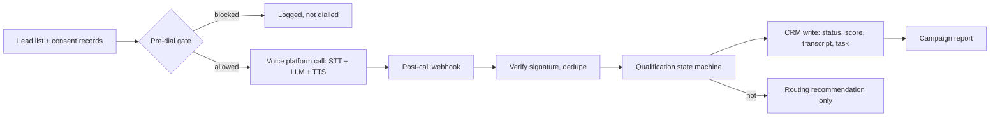

> **Proprietary - All Rights Reserved.** Licensed to Sandeep Grover. No reuse, copying, modification, or distribution without prior written permission. See LICENSE.

# Real-estate seller-call lead qualifier (post-call layer)

The decision layer that sits behind an outbound AI voice agent (Retell AI, Vapi or Bland AI) for a real-estate acquisitions team:

1. **Pre-dial compliance gate** (`compliance.py`): supplied internal and national Do-Not-Call flags and a supplied consent boolean, attempt limits, and an 8:00-21:00 calling window evaluated in the lead's own time zone. These are fictional test inputs, not proof of legal permission or a complete jurisdiction policy.
2. **Qualification state machine** (`qualification.py`): walks the five seller questions in order (interest, condition, price, timeline, repairs), stays on a question until it is answered, stops processing the transcript on "not interested", an opt-out or a wrong-person answer. Produces a 0-100 motivation score and a CRM status (hot, warm follow-up, nurture, not interested, do not call, voicemail, no contact).
3. **Post-call webhook handler** (`pipeline.py`): HMAC signature check, sequential duplicate-event detection using an in-memory mock, CRM write of status, score, answers, summary and full transcript, follow-up task scheduling, and do-not-call propagation.
4. **Reporting** (`reporting.py`): dials, connections, connect rate, qualified leads, transfers, opt-outs.



The live conversation runs on the voice platform's LLM agent. This repository is the deterministic, testable layer around it. Qualification here is rule-based so routing decisions are auditable; it does not call any AI model.

## Run

```bash
python -m pip install -r requirements.txt
python -m pytest -q        # 23 tests
python main.py             # runs constructed example calls through a mocked CRM
```

No phone calls are placed, no real CRM is touched and no API keys are needed. All names, numbers and transcripts in `synthetic_calls.jsonl` are constructed examples.

## Boundaries of the example

No live Retell/Vapi/Bland adapter, dialler, audio, voice model, transfer, calendar or real CRM connector is implemented. The `transfer` output is a recommendation based on the score; it does not verify a successful transfer. The reporting `hot_transfers` count is this recommendation count, not an independently measured telephony outcome.

The custom HMAC example is not claimed compatible with any provider signature format; it has no timestamp replay window. A repeated completed event is ignored sequentially, but partial writes, crashes and concurrent requests can duplicate notes/tasks. Production requires persistent event claims, reconciliation, provider-specific verification, retention controls and end-to-end tests.

The rule parser consumes fictional completed transcripts in an expected order; it cannot interrupt or stop a live call. Scores are illustrative heuristics, not validated predictions of conversion or property value. Consent booleans and DNC flags are supplied test inputs: no registry is queried and consent wording, evidence, revocation, campaign purpose or jurisdictional sufficiency is verified. The 08:00-21:00 default is a demo setting, not a legal recommendation.
